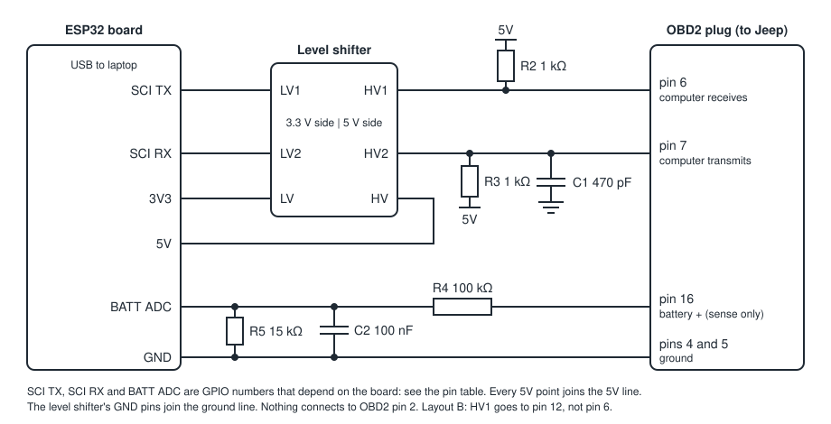

# SCI interface hardware — ESP32 version

An alternative to the [Arduino Mega board](sci-interface-hardware.md), built on
an ESP32 board with this project's own firmware. Both do the same job and are
driven by the same `tjdiag mem` commands.

Two ESP32 boards are supported. The firmware picks the right pins for whichever
one it is compiled for.

- **Waveshare ESP32-C5-WIFI6-KIT** (ESP32-C5-WROOM-1 module, pre-soldered headers)
- **ESP32 DevKit** with a WROOM-32 module (the common 30- or 38-pin board)

> **Status:** the firmware's logic has been tested on a laptop against a
> simulated engine computer (see [What has been tested](#what-has-been-tested)).
> It has not been compiled with the ESP32 toolchain, flashed to a board, or
> connected to a vehicle. Your Arduino IDE will be its first real compile.



## Which board: Mega or ESP32

| | Mega 2560 | ESP32 |
|---|---|---|
| Firmware | Upstream ChryslerScanner, which has run on real Chrysler computers | This project's, new and unproven on a vehicle |
| Can the firmware write to the computer? | It contains write and reprogramming features; only our scripts keep them out of reach | No. It contains read commands only |
| Level shifter needed | No (5 V board) | Yes (3.3 V board) |
| Independent cross-check | The upstream Windows program works on the same board | None |
| Battery reading | Approximate; good enough for the low-battery guard | The same |

If you have both, the Mega is the lower-risk choice. The ESP32 is the one that
physically cannot write.

## Why a level shifter

The engine computer's SCI lines work at 5 V. An ESP32's pins are 3.3 V and are
damaged by 5 V, and its 3.3 V output is not reliably read as "high" by a 5 V
input. The level shifter sits between the two. **Never connect an ESP32 pin
directly to the OBD2 plug.**

## Shopping list

Everything besides the ESP32 board itself:

| Qty | Part | Notes |
|---|---|---|
| 1 | Bidirectional logic level converter module, 3.3 V / 5 V | The common 4-channel BSS138 type, about $2–5, usually sold in packs. Two channels are used. Get one with header pins, or solder them |
| 1 | OBD2 male plug with pigtail (16-pin, J1962) | Sold as "OBD2 male to open wire" or "OBD2 male pigtail". Check that all 16 pins are populated, or at least pins 4, 5, 6, 7, 12 and 16 |
| 2 | 1 kΩ resistor | R2, R3 |
| 1 | 100 kΩ resistor | R4 |
| 1 | 15 kΩ resistor | R5 |
| 1 | 470 pF ceramic capacitor | C1 |
| 1 | 100 nF ceramic capacitor | C2 |
| 1 | Solderless breadboard | Full or half size |
| 1 set | Jumper wires | Male-to-male, plus female-to-male if the board will not sit on the breadboard |
| 1 | USB-C data cable | Not a charge-only cable |

A resistor assortment and a ceramic capacitor assortment cover all six small
parts for a few dollars. Quarter-watt resistors are fine.

Already needed for the rest of this project, and useful here: the multimeter,
and a battery charger or maintainer for the Jeep during long reads.

## Pins

The schematic uses names; this table gives the pin for each board.

| Schematic name | Waveshare ESP32-C5-WIFI6-KIT | ESP32 DevKit (WROOM-32) |
|---|---|---|
| SCI TX (to the computer) | GPIO24 | GPIO17 |
| SCI RX (from the computer) | GPIO23 | GPIO16 |
| BATT ADC | GPIO4 | GPIO34 |
| 5V | 5V | VIN (also marked 5V) |
| 3V3 | 3V3 | 3V3 |
| GND | GND (any) | GND (any) |

On the Waveshare board the pins were chosen from its schematic to stay clear of
everything already in use: the chip's boot-mode pins (2, 3, 7, 25–28), the USB
pins (13, 14), the laptop serial pins (11, 12), the on-board battery monitor
(6), the RGB LED (27) and the BOOT button (28).

## Connections

| From | To | Purpose |
|---|---|---|
| ESP32 3V3 | Level shifter LV | 3.3 V reference |
| ESP32 5V | Level shifter HV | 5 V reference, from USB |
| ESP32 GND | Level shifter GND (both sides) | Ground |
| ESP32 SCI TX | Level shifter LV1 | Data to the computer |
| Level shifter HV1 | OBD2 pin 6 | The computer's SCI receive |
| 5V | R2, 1 kΩ, to HV1 | Makes the "high" level firm at the computer's input |
| ESP32 SCI RX | Level shifter LV2 | Data from the computer |
| Level shifter HV2 | OBD2 pin 7 | The computer's SCI transmit |
| 5V | R3, 1 kΩ, to HV2 | Pull-up: the computer's transmit line cannot drive high by itself |
| GND | C1, 470 pF, to HV2 | Noise filter |
| OBD2 pin 16 | R4, 100 kΩ, to BATT ADC | Battery voltage sense |
| BATT ADC | R5, 15 kΩ, to GND | Lower half of the divider |
| BATT ADC | C2, 100 nF, to GND | Steadies the reading |
| ESP32 GND | OBD2 pins 4 and 5 | Ground |

Nothing connects to OBD2 pin 2. The board is powered from USB only; do not
connect a lithium battery to the Waveshare board's battery socket for this.

Notes on the design:

- **R3 and C1** are the same values as the upstream Mega board uses on that line.
- **R2** is there because the level shifter's own pull-up is weak (10 kΩ). With
  1 kΩ the computer's input sees a firm 5 V whatever its input resistance is.
- **The level shifter also protects the ESP32.** If an OBD2 pin carried more
  than 5 V, its transistor blocks that from reaching the 3.3 V side.
- **R4 and R5** bring 15 V down to about 2 V, inside the range the ESP32
  measures. The firmware's divider constants match these values.
- The 5V pin can read 4.6–4.8 V under USB power. That is fine.

## Firmware

The sketch is in [`firmware/esp32-sci-bridge/`](../firmware/esp32-sci-bridge/).

1. Install the Arduino IDE, then add ESP32 support: *Boards Manager* → search
   "esp32" → install the package by Espressif Systems. The ESP32-C5 needs a
   recent version of that package (3.3 or later, as far as I know); if the
   ESP32-C5 board is not in the list, update the package.
2. Open `firmware/esp32-sci-bridge/esp32-sci-bridge.ino`. Keep `bridge_core.h`
   in the same folder.
3. Select the board and port:

   | | Waveshare ESP32-C5-WIFI6-KIT | ESP32 DevKit (WROOM-32) |
   |---|---|---|
   | *Tools → Board* | ESP32C5 Dev Module | ESP32 Dev Module |
   | USB port to use | The one marked **UART** | The only one |
   | *Tools → USB CDC On Boot* | Disabled | not shown |

4. Upload. If the upload does not start, hold the BOOT button while it begins.

No extra libraries are needed. If it does not compile, send me the error text;
this is the step I could not run here.

About the Waveshare board's two USB-C ports: its schematic shows one wired
through a USB-to-serial chip (CH343P) and one wired straight to the ESP32. Use
the serial-chip one, marked UART, for both flashing and `tjdiag`. If your board
has only one port, or you want to use the other one, set *USB CDC On Boot* to
*Enabled* instead and use that port for everything.

## Bench check, before the Jeep

With the board on USB and unplugged from the Jeep:

1. Check the wiring against the tables.
2. With a multimeter, black lead on ground:

   | Point | Expect |
   |---|---|
   | OBD2 plug pin 6 | About 5 V |
   | OBD2 plug pin 7 | About 5 V |
   | ESP32 SCI TX pin | About 3.3 V |
   | ESP32 SCI RX pin | About 3.3 V. **If this reads above 3.6 V, stop: the level shifter is wired backwards** |
   | ESP32 BATT ADC pin | About 0 V |
   | OBD2 plug pin 16 to ground, resistance | About 115 kΩ |

3. Fit the jumper between OBD2 plug pins 6 and 7, then:

   ```
   tjdiag ports
   tjdiag --port <port of the ESP32> mem selftest
   ```

   It should report the firmware as "tjdiag SCI bridge", the chip as ESP32, and
   "Serial loopback: PASS".
4. Remove the jumper.

## At the Jeep

The checks before plugging in, the question of connector layout A or B, and the
rules for use are the same as for the Mega board: see
[Checks at the Jeep](sci-interface-hardware.md#checks-at-the-jeep-before-plugging-in)
and [Using it](sci-interface-hardware.md#using-it). For layout B, move the HV1
wire from pin 6 to pin 12.

Then follow [memory-test.md](memory-test.md). The commands work the same; the
one difference is that there is no second program to cross-check readings
against.

## What the firmware does and does not do

- It accepts the same laptop commands as the upstream firmware for the features
  the scripts use: identity, status, battery voltage, enabling the SCI link,
  single messages and paced message lists, at 7812 and 62,500 baud.
- **It transmits only read messages**, and checks their exact length so that
  nothing can follow an allowed command: fault list, the ROM and EEPROM byte
  reads, the two speed-select bytes, and RAM table reads in high-speed mode.
  Anything else is answered with an error and never reaches the wire. This is
  a second, independent copy of the guard in the Python scripts.
- It has no bootstrap mode, no programming voltages, no transmission-computer
  channel and no support for other buses. Wi-Fi and Bluetooth are not used.

The packet format is the one the upstream ChryslerScanner firmware uses, so the
same scripts drive either board. The code is this project's own and is licensed
with the rest of this repository.

## What has been tested

All of the firmware's behaviour is in `bridge_core.h`, which has no ESP32
dependencies. The test suite compiles that file for the laptop, runs it, and
puts the real driver on one side and a byte-level simulated engine computer on
the other (`tests/test_firmware_core.py`). That covers packet handling, every
command, lists and pacing, a computer that goes silent, speed changes, RAM
tables, a resumed dump, and the guard: with the Python-side guard bypassed,
write, erase and security commands are refused and no byte reaches the
simulated computer.

The sketch around it (`esp32-sci-bridge.ino`, about 100 lines) is checked for
syntax and types against a stand-in for the Arduino API, once for each board.

Not tested, and only testable on your bench:

- Compiling with the real ESP32 toolchain, for either chip.
- The pin choices on the Waveshare board. They come from its schematic and
  Espressif's ESP32-C5 documentation, not from a board in hand.
- Serial timing at the real baud rates.
- The level-shifter circuit.
- What the board prints when the laptop opens its port. These boards reset and
  emit start-up text; the driver is written to skip it.
- Anything against the engine computer.
