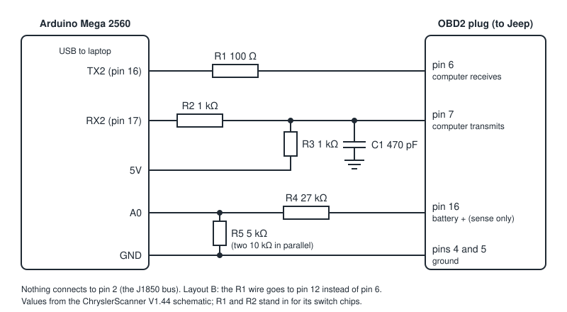

# SCI interface hardware — Arduino Mega version

A small board that lets the laptop talk to the engine computer over Chrysler's
SCI serial link, which is how its memory is read. It is an Arduino Mega 2560
running the open-source
[ChryslerScanner](https://github.com/laszlodaniel/ChryslerScanner) firmware,
plus five resistors and a capacitor.

There is also an [ESP32 version](sci-interface-esp32.md) with this project's
own read-only firmware; that page compares the two.

> **Status:** designed from the upstream project's schematic and firmware
> source. It has not been built or connected to a vehicle. The first two checks
> below (`mem selftest` on the bench, then the multimeter checks at the Jeep)
> exist to catch a mistake before it matters.



## Why a Mega 2560

The upstream firmware needs a Mega: about 46 KB of program space, 4 KB of RAM,
and a hardware serial port for the Jeep separate from the USB one. An Uno R3
has 32 KB, 2 KB and a single port, so it cannot run it. A Mega also has 5 V
logic, which is what the SCI lines use. A 3.3 V board such as an ESP32 must not
be wired to the Jeep the way this page shows; it needs the level shifter and
firmware described in the [ESP32 version](sci-interface-esp32.md).

## Parts

| Qty | Part | Notes |
|---|---|---|
| 1 | Arduino Mega 2560 (R3 or a clone) | With its USB cable |
| 1 | OBD2 male plug with pigtail (16-pin, J1962) | Sold as "OBD2 male to open wire"; only 5 wires are used |
| 1 | 100 Ω resistor | R1 |
| 2 | 1 kΩ resistor | R2, R3 |
| 1 | 27 kΩ resistor | R4 |
| 2 | 10 kΩ resistor | In parallel they make R5 (5 kΩ) |
| 1 | 470 pF ceramic capacitor | C1 |
| 1 | Protoboard or Mega screw-terminal shield | Anything that holds the parts firmly |
| 1 | Short jumper wire | For the bench self-test |

Quarter-watt resistors are fine. Total cost is roughly $30.

## Connections

| Mega | Through | OBD2 plug | Purpose |
|---|---|---|---|
| TX2 (pin 16) | R1, 100 Ω in series | pin 6 | Data to the computer (its SCI receive) |
| RX2 (pin 17) | R2, 1 kΩ in series | pin 7 | Data from the computer (its SCI transmit) |
| 5V | R3, 1 kΩ | pin 7 side of R2 | Pull-up: the computer's transmit line cannot drive high by itself |
| GND | C1, 470 pF | pin 7 side of R2 | Noise filter on the same line |
| A0 | R4, 27 kΩ in series | pin 16 | Battery voltage sense |
| GND | R5, 5 kΩ | A0 side of R4 | Lower half of the divider |
| GND | wire | pins 4 and 5 | Ground |
| USB | cable | laptop | Power and data |

Nothing connects to pin 2. That is the J1850 bus the ELM327 dongle uses; the
two tools are never plugged in at the same time, since there is one connector.

The Mega is powered from USB only. Pin 16 goes to the divider and nowhere else.

### Where the values come from

- **R3 and C1** are copied from the upstream V1.44 schematic, which labels the
  pull-up "SCI-TX bias, required by the design of the SCI-bus".
- **R4 and R5** match the divider constants in the firmware (27 kΩ and 5 kΩ), so
  the voltage it reports is correct without calibration. If you use a single
  5.1 kΩ instead of two 10 kΩ in parallel, readings come out about 2% low.
- **R1 and R2** are mine. The upstream board has analog switch chips in those
  positions; the resistors take their place and limit the current if a pin
  turns out to carry something other than SCI.

### Optional

Two more 10 kΩ resistors, from Mega pin 19 (RX1) to 5V and from pin 15 (RX3) to
5V. The firmware also listens on those ports for buses this Jeep does not use,
and tying them high stops them picking up noise. The scripts ignore that noise
either way.

## Firmware

Use the prebuilt file from the upstream repository, unchanged:

`Arduino/ChryslerCCDSCIScanner/ChryslerCCDSCIScanner.ino.mega.hex`

Flash it with `avrdude` (it ships with the Arduino IDE):

```
avrdude -p atmega2560 -c wiring -P <port> -b 115200 -D -U flash:w:ChryslerCCDSCIScanner.ino.mega.hex:i
```

The scripts were written against firmware 0.9.12 as found in that repository on
2026-11-12. `tjdiag mem selftest` prints the version the board reports and warns
if it is not 0.9.x.

The firmware is licensed GPLv3. Nothing from it is copied into this repository;
you download and flash it yourself.

Compiling it in the Arduino IDE instead also works, and needs three libraries:
LiquidCrystal_I2C, extEEPROM and CCDLibrary.

## Bench check, before the Jeep

1. With the board unplugged from everything except USB, look over the wiring
   against the table above.
2. With a multimeter on the OBD2 plug, Mega powered:
   - pin 7 to pins 4/5: about 5 V (the pull-up)
   - pin 6 to pins 4/5: about 5 V (the serial line idles high)
   - pin 16 to pins 4/5: about 0 V, and 32 kΩ of resistance
   - pins 4 and 5 to Mega GND: continuity
3. Fit the jumper between plug pins 6 and 7, then:

   ```
   tjdiag ports
   tjdiag --port <port of the Mega> mem selftest
   ```

   Every line should be `PASS` or `INFO`. "Serial loopback: PASS" means a byte
   sent on TX2 came back on RX2 through your resistors.
4. Remove the jumper.

This is also the first test of the firmware on a bare Mega, with none of the
upstream board's extra chips. If the handshake fails here, stop and send me
`tjdiag-data/mem/traffic.log`.

## Checks at the Jeep, before plugging in

With the key ON, engine off, and the multimeter's black lead on plug pin 4 or 5
of the Jeep's connector:

| Jeep connector pin | Expect | If not |
|---|---|---|
| 16 | Battery voltage | Blown fuse or wrong pin count |
| 6 | 5.5 V or less | **Do not plug in.** Anything near battery voltage means this pin is not SCI on this vehicle |
| 7 | 5.5 V or less | Same |

Then confirm the pin assignment against the 2004 TJ factory wiring diagram for
the data link connector. Chrysler used two layouts:

- **Layout A:** computer receives on pin 6, transmits on pin 7. This is what the
  board is wired for, and the upstream project's default.
- **Layout B:** computer receives on pin 12 instead. If the diagram shows that,
  move the R1 wire from pin 6 to pin 12. Nothing changes in the software.

I could not confirm which layout a 2004 Wrangler uses; sources for neighbouring
model years disagree. If `mem probe` reports no echo with layout A and the
checks above are fine, layout B is the next thing to try.

## Using it

- Laptop running on its own battery, not its charger. That keeps the only
  ground path between laptop and Jeep the one through the plug.
- A battery charger or maintainer on the Jeep for any read longer than a few
  minutes. The key is on with the engine off the whole time.
- Plug in with the key off, then turn the key to ON.
- Unplug the ELM327 dongle first; there is only one connector.

Then follow [memory-test.md](memory-test.md).

## What it cannot do

- **Write anything.** The scripts refuse every command that writes, erases or
  operates an actuator before it reaches the wire, and the firmware's own
  bootstrap and programming features are not reachable from them.
- **Bootstrap mode.** Reading memory through an uploaded loader needs 12 V on a
  signal pin and loader code that is not in the published source. It is out of
  scope; this board has no way to apply that voltage.
- **The transmission computer.** Its SCI lines are on different pins and, per
  the upstream documentation, are used for reprogramming only.
